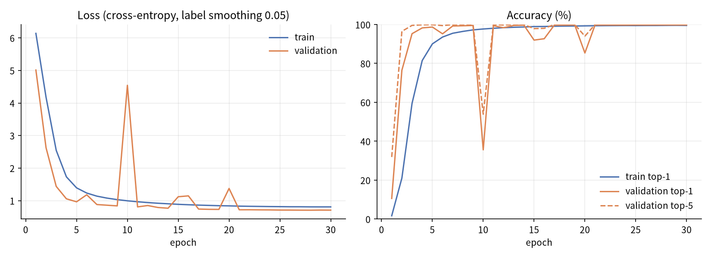
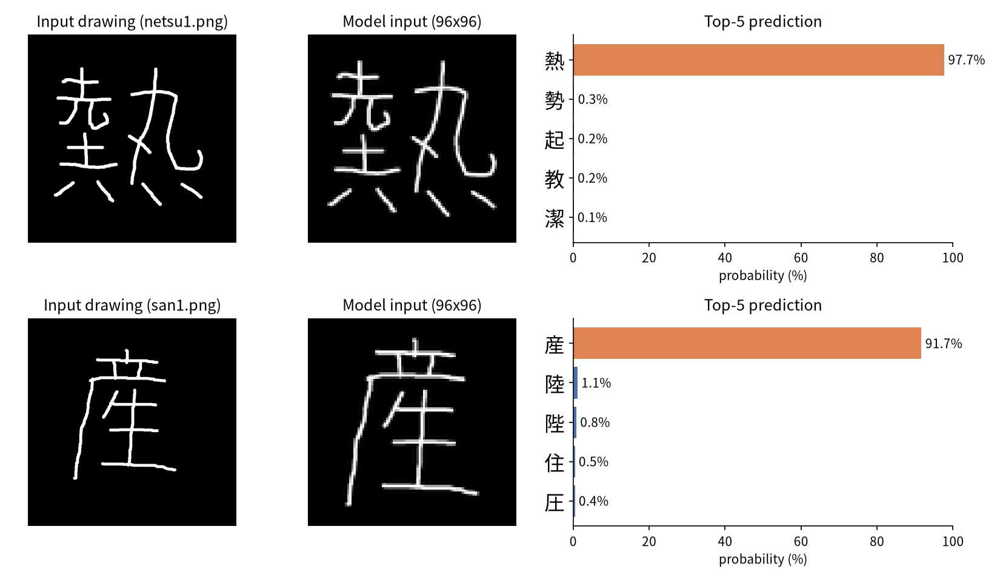
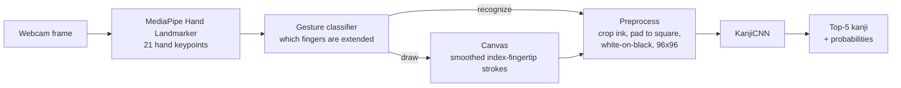

# Air Kanji: Hand-Drawn Kanji Recognition

Draw a kanji **in the air with your index finger** in front of a webcam. A CNN trained on the ETL8G handwriting database recognizes it **from its final shape alone**, so stroke order and stroke count don't matter.

<!-- Demo: record with the steps in "Recording the demo" below, then uncomment.
<p align="center"></p>
-->

| | |
|---|---|
| **Classes** | 881 kanji (ETL8G, hiragana removed) |
| **Test top-1 accuracy** | **99.80 %** |
| **Test top-5 accuracy** | **99.97 %** |
| **Model** | CNN (8 conv layers), 1.4 M parameters, 96×96 grayscale input |
| **Input** | Webcam + MediaPipe Hand Landmarker (gesture control), or any image file |
| **Stack** | Python · PyTorch · OpenCV · MediaPipe |

## Motivation

Anyone learning Japanese (or Korean hanja) looks up unfamiliar characters all the time. Most handwriting lookup tools (e.g. japandict.com, Naver dictionary) recognize characters from the **sequence and number of strokes**. If you get the stroke order "wrong", the correct character drops down the list or isn't found at all, even when the drawing looks exactly right.

This project takes a different approach: it treats recognition as **image classification**. Only the finished drawing is used, and a convolutional neural network returns the 5 most likely characters.

## Results

The model was trained on an 80 / 10 / 10 stratified split of ETL8G (113,649 / 14,096 / 14,096 images). Test-set metrics come from [`runs/test_metrics.json`](runs/test_metrics.json):

| Split | Top-1 | Top-5 |
|---|---|---|
| Validation (best epoch 27) | 99.82 % | 99.99 % |
| **Test** | **99.80 %** | **99.97 %** |



The validation dips around epochs 10 and 20 are transient; training recovers right away as the cosine schedule lowers the learning rate.

**Predictions on my own drawings** (`samples/`), which are not from ETL8G:



> ETL8G accuracy is very high because it's one consistent, scanned, pen-on-paper dataset. Accuracy on air-drawn input hasn't been measured systematically yet (see [Limitations](#limitations--future-work)).

## How it works



### 1. Hand tracking and gestures

[MediaPipe Hand Landmarker](https://ai.google.dev/edge/mediapipe/solutions/vision/hand_landmarker) returns 21 3-D keypoints per frame. A finger counts as *extended* when the MCP–PIP–tip angle is nearly straight and the tip is farther from the wrist and knuckle than the middle joint is. The pattern of extended fingers is the command:

| Gesture | Action |
|---|---|
| Fist, or index + pinky | Idle (pen up) |
| Index finger | Draw (the fingertip is the pen) |
| Index + middle | Undo last stroke |
| Index + middle + ring | Recognize |
| Four fingers | Clear canvas |

Gestures are debounced: a gesture has to stay stable for several frames, and undo/recognize/clear only fire when coming from idle (with a cooldown), so the app doesn't trigger by accident. Fingertip positions are smoothed with an exponential moving average before they're drawn.

Keyboard fallback: `r` recognize · `u` undo · `c` clear · `s` save canvas · `q`/`Esc` quit.

### 2. Preprocessing

The same steps run on ETL8G training images and on the live canvas, so both look alike to the model. The steps are: convert to grayscale, crop to the ink bounding box, pad to a square with a 12% margin, normalize to white strokes on black, and resize to 96×96 (see `preprocess_kanji_image` in [`train_kanji_cnn.py`](train_kanji_cnn.py)).

### 3. CNN

```
Input 1×96×96
→ ConvBlock(32)  → ConvBlock(64) → ConvBlock(128) → ConvBlock(256)
   each block: [Conv3×3 → BN → ReLU] ×2 → MaxPool2×2 → Dropout2d (0.05 → 0.20)
→ Global average pooling → Dropout(0.4) → Linear(256 → 881)
```

| Training setting | Value |
|---|---|
| Optimizer | AdamW, lr 3e-4, weight decay 1e-4 |
| LR schedule | Cosine annealing over 30 epochs |
| Loss | Cross-entropy with label smoothing 0.05 |
| Batch size | 128 |
| Augmentation | Random affine: ±8° rotation, ±8% shift, 0.9–1.1 scale, ±5° shear (no flips) |
| Hardware | Google Colab GPU |

## Quick start

The trained model and the MediaPipe hand model are included, so no training or dataset is needed to try it.

```bash
git clone https://github.com/ManilaSR57/kanji-recognizer.git
cd kanji-recognizer
python -m venv .venv && source .venv/bin/activate   # Windows: .venv\Scripts\activate
pip install -r requirements.txt
```

**Recognize an image file:**

```bash
python predict_kanji.py --checkpoint runs/best_model.pt --image samples/netsu1.png
```
```
1. 熱  probability=0.9772
2. 勢  probability=0.0026
3. 起  probability=0.0019
4. 教  probability=0.0017
5. 潔  probability=0.0012
```

**Draw in the air with your webcam:**

```bash
python hand_draw_kanji.py --checkpoint runs/best_model.pt --hand-model models/hand_landmarker.task --brush-size 10
```

Useful options: `--camera 1` (another webcam), `--top-k 10`, `--stable-frames 5` (gesture debounce), `--smooth-alpha 0.35` (stroke smoothing). Run with `--help` for the full list.

Tested with Python 3.14, PyTorch 2.14 (CPU), and MediaPipe 1.1 on Linux. A GPU is used automatically if available, but it isn't required for inference.

## Training from scratch

The ETL8G dataset isn't included: the [ETL Character Database](http://etlcdb.db.aist.go.jp/) requires registration, and its terms don't allow redistribution.

1. Request and download ETL8G from the official site.
2. Unpack it into a folder of PNG images plus a CSV. The first column is the image id (file name stem, e.g. `000123`) and the second is the label (`日`, `U+65E5`, `0x65E5` and decimal code points are all accepted). Hiragana classes were removed for this project.
3. Train:

```bash
python train_kanji_cnn.py \
    --data-dir data/etl8g \
    --csv-name kanji_codes.csv \
    --out-dir runs/my_run \
    --image-size 96 \
    --output-polarity white_on_black \
    --epochs 30 --batch-size 128 --lr 3e-4 --seed 42
```

This writes `best_model.pt`, `last_model.pt`, `history.csv`, `test_metrics.json`, the label maps, and the train/val/test split CSVs to `--out-dir`. The checkpoint stores its own preprocessing settings, so `predict_kanji.py` and `hand_draw_kanji.py` work with it unchanged.

To regenerate the README figures: `python scripts/make_figures.py`.

## Project structure

```
kanji-recognizer/
├── train_kanji_cnn.py          # data loading, preprocessing, KanjiCNN, training & evaluation
├── predict_kanji.py            # top-k prediction for a single image file
├── hand_draw_kanji.py          # webcam app: MediaPipe hand tracking, gestures, canvas, live recognition
├── scripts/
│   └── make_figures.py         # builds assets/training_curves.png and assets/predictions.png
├── runs/
│   ├── best_model.pt           # trained weights + label map + preprocessing config
│   ├── history.csv             # per-epoch loss / top-1 / top-5 (train & val)
│   ├── test_metrics.json       # final test-set metrics
│   ├── idx_to_kanji.json       # class index -> kanji
│   └── kanji_to_idx.json       # kanji -> class index
├── models/
│   ├── hand_landmarker.task    # MediaPipe Hand Landmarker model (Google, Apache-2.0)
│   └── LICENSE-hand_landmarker.txt
├── samples/                    # my own handwritten test images
├── assets/                     # README images
└── requirements.txt
```

## Limitations & future work

- **Domain gap:** the model is trained on pen-on-paper scans, while air-drawn strokes are shakier and have uniform thickness. The next step is to collect a labelled set of air-drawn kanji and measure top-1/top-5 on it, then fine-tune if needed.
- **Air-drawing comfort:** holding your arm up to draw complex characters is tiring. Better smoothing, or a "pen down" pinch gesture, could help.
- **Vocabulary:** limited to the 881 kanji in ETL8G. ETL9G (2,965 classes) would cover far more.
- **Features:** links to online dictionaries for the recognized character, a quiz mode, and lower latency (e.g. ONNX export).

## Acknowledgements

- **ETL Character Database (ETL8G):** Electrotechnical Laboratory, Japanese Technical Committee for Optical Character Recognition, ETL Character Database, 1973-1984, Japan: <http://etlcdb.db.aist.go.jp/>. The training data comes from ETL8G, used under the database's terms of use.
- **MediaPipe Hand Landmarker:** Google, [model page](https://ai.google.dev/edge/mediapipe/solutions/vision/hand_landmarker). The bundled `models/hand_landmarker.task` is redistributed unmodified under the Apache License 2.0 (see [`models/LICENSE-hand_landmarker.txt`](models/LICENSE-hand_landmarker.txt)).

## License

The code is released under the [MIT License](LICENSE). The bundled `hand_landmarker.task` is distributed under Apache-2.0 by Google. The trained weights were derived from ETL8G and are shared for research and educational use. The ETL8G data itself is subject to the ETL database's terms of use.
